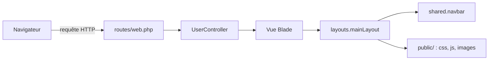
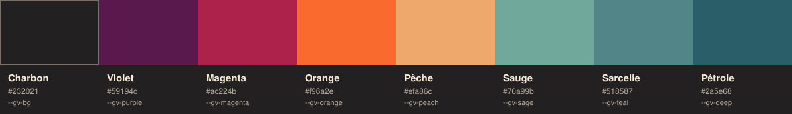

<h1 align="center">The Music Memory</h1>

<p align="center">
  <em>Cataloguer et partager sa collection musicale : albums, musiques et wishlist</em>
</p>
<p align="center">
  
</p>
<p align="center">
  
  
  
  
</p>

<p align="center">
  <a href="#fonctionnalités">Fonctionnalités</a> ·
  <a href="#architecture">Architecture</a> ·
  <a href="#direction-artistique">Direction artistique</a> ·
  <a href="#feuille-de-route">Feuille de route</a>
</p>

---

## À propos

**The Music Memory** est une application web Laravel qui permet à chaque utilisateur de constituer sa collection d'albums qu'il possède et de suivre sa wishlist. L'interface s'appuie sur une identité visuelle inspirée des années 70 : bandes colorées, ombres dures et typographie à empattements arrondis.

## Fonctionnalités

| État | Fonctionnalité |
|:---:|---|
| Disponible | Inscription et connexion |
| Disponible | Espace compte : changement de mot de passe, déconnexion, suppression du compte |
| Disponible | Barre de recherche |
| Disponible | Onglets Albums, Musiques, Wishlist et Amis |
| Démo | Carrousel 3D des albums (données de démonstration) |
| À venir | Recherche d'albums et d'artistes |
| À venir | Collection alimentée par la base de données |

## Stack technique

| Couche | Technologie |
|---|---|
| Serveur | Laravel (PHP) |
| Vues | Blade |
| Interface | Bootstrap 5.3.8 (CDN jsDelivr) |
| Styles | CSS personnalisé basé sur des variables (`public/css/style.css`) |
| Scripts | JavaScript natif|
| Polices | Caprasimo (titres) et Instrument Sans (texte), via Google Fonts |
| Base de données | [à compléter] |

## Architecture



```text
.
├── app/Http/Controllers/
│   └── UserController.php          Inscription, connexion, compte
├── resources/views/
│   ├── layouts/
│   │   └── mainLayout.blade.php    Gabarit commun, seul @yield('content') change
│   ├── shared/
│   │   ├── navbar.blade.php        Barre du haut, fixe sur toutes les pages
│   │   └── message.blade.php       Messages de retour
│   └── account.blade.php           Page « Ma collection »
├── public/
│   ├── css/                        style.css, carrousel.css, background.jpg
│   ├── js/                         app.js, caroussel.js
│   └── img/albums/                 Pochettes du carrousel
├── docs/                           Visuels du README
└── routes/web.php
```

Le layout expose deux emplacements pour les assets propres à une page : `@stack('head')` pour le CSS et `@stack('scripts')` pour le JavaScript.

## Direction artistique

<p align="center">
  
</p>

La palette est mesurée sur l'image de fond du projet : un charbon et sept bandes de couleur, reprises en haut de chaque page.

**Principes**

- Angles droits partout.
- Bordures de 2 px et ombres dures, sans flou.
- Sept bandes colorées sous la barre de navigation.
- Titres en Caprasimo, texte courant en Instrument Sans.


## Conventions

- Toute classe CSS personnalisée est préfixée `tmm-` pour éviter les collisions avec Bootstrap. (tmm pour The Music Memory)
- Les couleurs et les formes passent par les variables de `style.css`, jamais en dur.
- Un composant avec ses propres assets les déclare avec `@push('head')` et `@push('scripts')`.
- Aucun code Blade dans les fichiers de `public/`.

## Feuille de route

- [ ] Brancher la recherche : le champ de la barre n'a pas encore de destination
- [ ] Alimenter le carrousel depuis la base de données (`@json` côté vue)
- [ ] Passer `admin/signout` en POST et `admin/deleteuser` en DELETE, avec protection CSRF
- [ ] Vérifier que le groupe `admin/*` est protégé par le middleware `auth`
- [ ] Limiter les tentatives sur `authenticate` et `adduser` (`throttle`)
- [ ] Demander le mot de passe avant la suppression d'un compte
- [ ] Renommer le préfixe `admin/` : il désigne l'espace utilisateur, pas une administration
- [ ] Héberger et compresser les images (`background.jpg`, pochettes)

## Licence et auteur

###  License

This project is licensed under the MIT License - see [LICENSE](LICENSE) for details.

Auteurs : @Lejo54 @toki-tofu @KitsuneNoMegami @Arthur